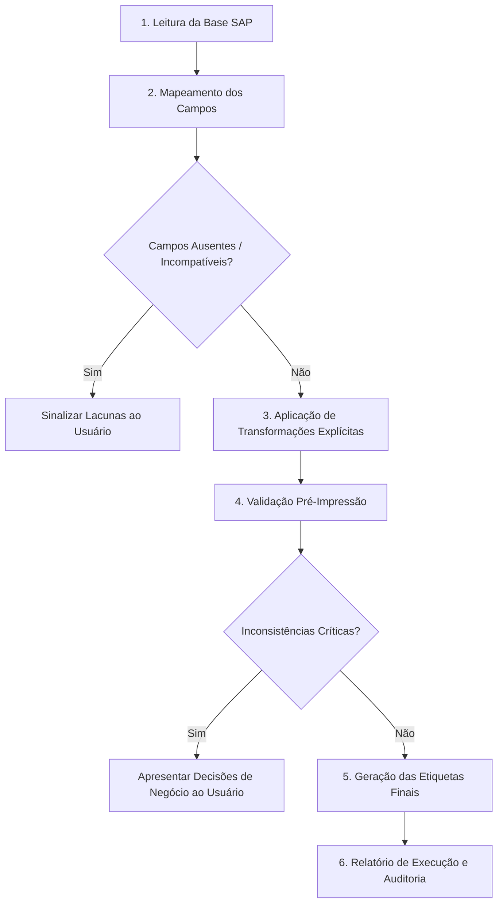

# Gerador e Validador de Etiquetas SAP

Esta skill padroniza o fluxo de ponta a ponta para geração de etiquetas industriais e logísticas a partir de extrações do SAP. Garante integridade de dados, compatibilidade de layout físico e aderência estrita às regras do SAP e do modelo de etiqueta.

---

## 1. Entradas Obrigatórias e Esperadas

Antes de gerar qualquer etiqueta, confirme o fornecimento ou a localização dos seguintes itens:

1. **Base de Dados SAP**:
   - Arquivo em formato CSV, Excel (`.xlsx`/`.xls`) ou TXT exportado do SAP (ex: transações SE16N, SQVI, VL06P, MB52, Z-reports).
   - **Regra de Segurança**: Trabalhe sempre sobre uma cópia da base de dados; nunca altere o arquivo de origem diretamente.

2. **Modelo de Etiqueta (Template)**:
   - Especificação do layout: dimensões (ex: 100x50 mm, 4x6 polegadas, DPI da impressora: 203 dpi ou 300 dpi).
   - Formato do modelo: ZPL (Zebra), EPL, TSPL, HTML/CSS, report PDF ou ZebraDesigner.
   - Lista de campos exigidos e opcionais com posição, limites de caracteres e tipos de código de barras/QR (Code 128, Datamatrix, EAN-13, QR Code).

3. **Parâmetros de Destino (se não informados explicitamente)**:
   - Formato de saída final (ex: arquivo de comandos `.zpl` ou `.prn` em texto puro, PDF multipáginas para impressão gráfica, ou imagem).
   - Tipo de impressora de destino (Zebra, Argox, Datamax, impressora térmica de mesa ou impressora laser/folha A4).

---

## 2. Fluxo de Execução Passo a Passo

---

### Passo 1: Leitura e Diagnóstico da Base SAP

1. Carregue o arquivo com ferramenta compatível (ex: script Python com `pandas` ou análise estruturada).
2. Identifique e apresente ao usuário:
   - Nome e formato do arquivo.
   - Cabeçalhos detectados (nomes técnicos do SAP como `MATNR`, `MAKTX`, `CHARG`, `MENGE`, `MEINS`, ou descrições em português).
   - Quantidade total de registros (linhas).
   - Delimitadores (no caso de CSV/TXT: ponto e vírgula, vírgula, tabulação) e codificação de caracteres (`UTF-8`, `ISO-8859-1` / Latin-1, `Windows-1252`).

---

### Passo 2: Mapeamento de Campos

Monte e exiba uma matriz de mapeamento antes da geração:

| Campo no Modelo | Obrigatório? | Campo Correspondente no SAP | Tipo / Limite Máximo | Status / Observação |
| :--- | :---: | :--- | :--- | :--- |
| Ex: `COD_MATERIAL` | Sim | `MATNR` | Alfanumérico (18) | Mapeado |
| Ex: `DESCRICAO` | Sim | `MAKTX` | Texto (40) | Mapeado (requer truncamento) |
| Ex: `LOTE` | Não | `CHARG` | Alfanumérico (10) | Mapeado |
| Ex: `DATA_VAL` | Sim | `VFDAT` | Data (DD/MM/AAAA) | Requer transformação de data |

**Regras de Parada e Alerta**:
- Se houver campos obrigatórios do modelo ausentes na base SAP, **não invente dados**. Informe a lacuna imediatamente e solicite a orientação do usuário.
- Se houver múltiplos campos com nomes semelhantes no SAP (duplicidades de cabeçalho), aponte a ambiguidade e peça confirmação.

---

### Passo 3: Transformação de Dados SAP

Aplique apenas transformações explícitas e devidamente documentadas. Mantenha os valores idênticos ao SAP, exceto onde o padrão da etiqueta exigir:

1. **Códigos de Material e Clientes (Remoção de Zeros à Esquerda)**:
   - No SAP, campos numéricos como `MATNR` costumam vir com zeros à esquerda (ex: `000000000010045678`).
   - Transformação: Aplicar desformatação (`lstrip('0')` ou equivalente à função de conversão `ALPHA_OUTPUT`), resultando em `10045678`, a menos que o modelo exija largura fixa.
2. **Datas**:
   - Padrão SAP (`YYYYMMDD` ou `YYYY-MM-DD`) $\rightarrow$ Formato da etiqueta (comumente `DD/MM/AAAA` ou `DD.MM.YYYY`).
3. **Números Decimais e Quantidades**:
   - Converter notação SAP (ponto decimal ou vírgula conforme o perfil do usuário no SAP) para o padrão solicitado no modelo. Exemplo: `100.000` $\rightarrow$ `100` ou `12,500 KG` $\rightarrow$ `12,5 kg`.
4. **Unidades de Medida**:
   - Manter as unidades padrão SAP (`ST`, `KG`, `M`) ou converter para a nomenclatura comercial solicitada (`UN`, `PC`), documentando a conversão.
5. **Limites de Caracteres e Quebra de Linha**:
   - Se uma descrição (`MAKTX`) exceder a largura do bloco de texto da etiqueta, quebre a linha de forma inteligente (respeitando limites de palavras) ou proponha truncamento, garantindo que o sentido do produto não seja alterado.
   - Em comandos ZPL com bloco de texto `^FB`, configure a largura e o número máximo de linhas para evitar que o texto sobreponha outros elementos.

Consulte [Regras Detalhadas de Transformação SAP](./references/regras-transformacao-sap.md) para detalhes adicionais.

---

### Passo 4: Validação Pré-Impressão

Antes de gerar o arquivo final, execute as seguintes checagens:

1. **Campos Obrigatórios**: Todos os registros a serem impressos possuem valores válidos preenchidos nos campos obrigatórios.
2. **Valores Vazios / Nulos**: Registros com campos críticos nulos devem ser sinalizados e, se necessário, descartados com justificativa.
3. **Caracteres Especiais e Escape**:
   - Em modelos ZPL: Tratar o acento circunflexo `^` e o til `~`, que são caracteres de comando do Zebra Programming Language. Use `^FH\` ou codificação hexadecimal quando necessário.
   - Tratar quebras de linha (`\r`, `\n`) indevidas dentro de campos de texto.
4. **Códigos de Barras e QR Codes**:
   - Confirmar se o dado a ser codificado atende às regras do tipo de código (ex: EAN-13 aceita apenas 13 dígitos numéricos válidos com dígito verificador; Code 128 aceita conjunto ASCII; QR Code / Datamatrix suportam strings completas).
   - Verificar se caracteres especiais suportados no padrão do leitor não corromperão a leitura (ex: separadores GS1 `[FNC1]`).

---

### Passo 5: Geração da Saída Final

1. Gere o arquivo no formato solicitado:
   - **ZPL (.zpl / .prn / .txt)**: Comandos ZPL completos iniciando com `^XA` e terminando com `^XZ` para cada etiqueta, agrupados no arquivo de lote.
   - **PDF (.pdf)**: Documento com uma página por etiqueta nas dimensões exatas especificadas.
   - **Outros Formatos**: Conforme a necessidade do usuário (HTML para preview, CSV tratado para softwares como Bartender ou NiceLabel).
2. Salve o arquivo gerado em caminho seguro no workspace (ex: `saida/etiquetas_geradas.zpl`).

---

### Passo 6: Relatório de Entrega e Auditoria

Ao concluir, forneça um relatório claro contendo:

- **Total de registros lidos da base**: $N$
- **Total de etiquetas geradas com sucesso**: $M$
- **Total de registros descartados ou ignorados**: $D$
- **Lista de descartes e inconsistências**: Listagem com ID/Linha e o motivo específico (ex: "Linha 14 descartada: campo MATNR vazio").
- **Tabela resumo das transformações aplicadas**: Explicando as regras adotadas.
- **Instruções de envio para a impressora**: Exemplo de envio via rede (porta 9100), USB ou comando no Windows.

---

## 3. Diretrizes de Comunicação e Tom de Voz

- **Idioma**: Sempre responda em português, de forma clara, técnica e objetiva.
- **Decisões de Negócio**: Não decida unilateralmente em casos ambíguos. Apresente os cenários (ex: "O registro possui quantidade zero. Opção A: Descartar registro; Opção B: Imprimir com alerta na etiqueta. Qual prefere?").
- **Integridade**: Não preencha lacunas com dados fictícios. Indique claramente se faltar informação essencial.

